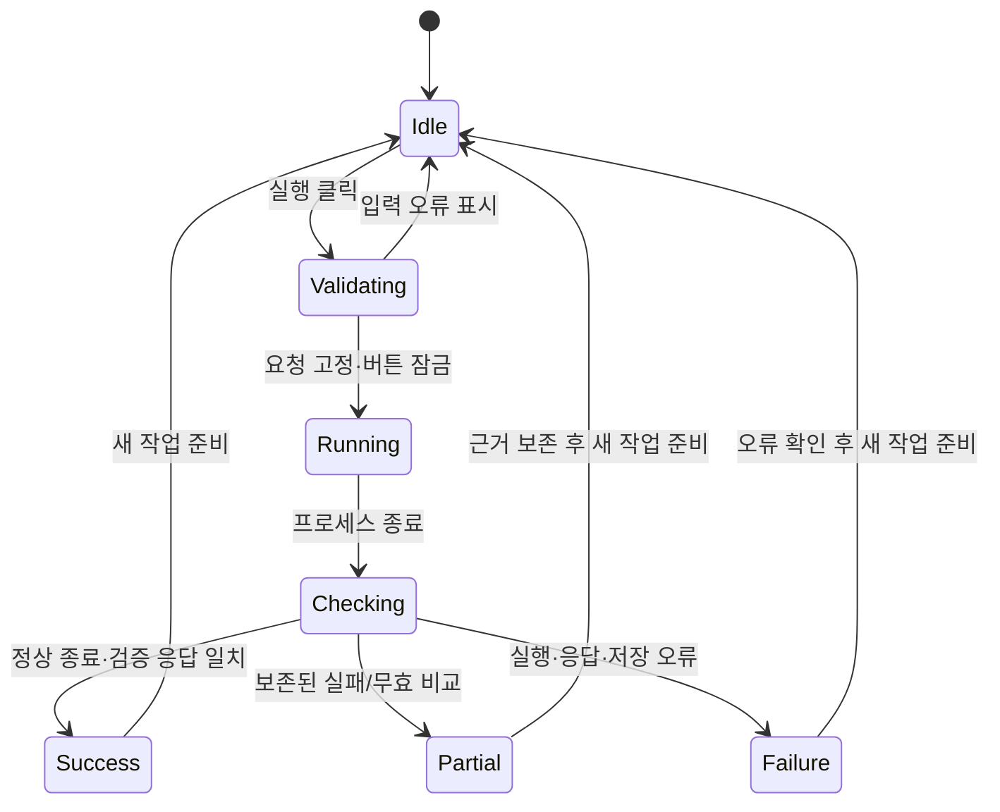

# GUI/Demo 최소 화면·실행 흐름 설계 v1

작성일: 2026-10-23. 설계 ID: `gui_demo_design_v1`. 시작 HEAD: `f1d8388`.
상태: **설계 완료, GUI·작업 실행 계층 구현 및 화면 검증은 미완료**.

근거: [공식 프로토콜 26~27절](../research_protocol_v2.md), [통합 CLI](unified_cli.md),
[Smart 압축·복원](smart_mode.md), [Compare](compare_mode.md),
[사용자 memory 결정](memory_reference_indicator_decision_20261023.md).
[환경·계약 확인 기록](gui_demo_design_v1_checks.json)에 실제 코드·기존 출력의 근거를 남긴다.

## 1. 목표와 구현 방식

로컬 Windows에서 파일을 선택하고 Smart 압축·복원·실제 비교를 실행하는 최소 Demo를 만든다.
프로토콜의 1차 후보인 Tkinter/ttk를 사용한다. 현재 Python에서 tkinter import와
창을 생성하지 않는 Tcl 인터프리터 초기화를 확인했으며 Tcl 8.6.15/Tk 8.6이 관측됐다.
이는 설치 확인이며 실제 창 생성·렌더링·응답성 검증은 아니다.

GUI는 기존 `main.py`를 별도 Python 프로세스로 호출한다. 측정·특징·모델·정답·복원 검증은
기존 backend가 담당한다. 웹 서버·외부 전송·새 GUI 의존성·연구 가중치 변경을 추가하지 않는다.

초기 구성은 `gui_app.py`의 Tk 화면과 Tk에 의존하지 않는 `src/gui_jobs.py`의 작업 실행·
응답 정규화 계층으로 나눈다. 먼저 작업 계층을 검증하고, 이후 화면을 연결한다.
기존 통합 CLI와 독립 CLI를 유지한다. `main.py`에 GUI 명령을 추가하는 것은 초기 필수 범위가 아니다.

## 2. 화면 구성

한 창에 **Smart 압축 / 복원 / 실제 비교** 탭을 둔다. 실행 가능한 작업은 창 전체에서 하나다.
사용자 표시와 기능을 다음처럼 고정한다. 아래 그림은 값이 없는 설계용 wireframe이며 실험 결과가 아니다.

```text
Smart Compression                         [Smart 압축] [복원] [실제 비교]

입력 파일 또는 압축 결과 폴더   [선택한 경로                         ] [찾기]
파일 정보                       이름 / bytes / 확장자 또는 package
출력 부모 폴더                  [선택한 경로                         ] [찾기]
새 결과 폴더 이름               [이름                                ]

Smart 전용: 사용 목적 [선택]    모델 [선택]    [모델 폴더 설정]
                         [선택한 작업 실행]

상태: 대기 / 입력 확인 / 실행 중 / 결과 확인 / 완료·실패
[완료율을 추정하지 않는 실행 표시]

결과: 검증 상태 / 파일 정보 / 실제 결과 표 / 예측 또는 mode별 best
[상세 기록]  [결과 경로 복사]
```

| 영역 | Smart 압축 | 복원 | 실제 비교 |
|---|---|---|---|
| 입력 선택 | 원본 파일 | manifest·payload가 있는 폴더 | 원본 파일 |
| 사용 목적 | Archive / Balanced / Fast Access 필수 선택 | 표시하지 않음 | 세 mode 결과를 저장하고 보기만 전환 |
| 모델 | Decision Tree / Random Forest 필수 선택 | 표시하지 않음 | 모델을 불러오지 않음 |
| 모델 폴더 | 기본 Pilot 경로, 직접 만든 신뢰 가능한 폴더 지정 가능 | 해당 없음 | 해당 없음 |
| 실행 버튼 | `예측해 압축` | `검증해 복원` | `네 알고리즘 실제 비교` |
| 정상 결과 | 선택 알고리즘·압축 크기/비율·복원 검증·실제 특징·예측 출력 | 복원 파일명·크기·SHA-256·검증 | 알고리즘별 실제 측정·검증 및 mode별 최적 알고리즘·점수 |

작업과 연구의 사용 목적을 같은 “모드” 필드로 혼용하지 않는다. Smart 모델은 시험 성능을
보고 자동 선택하지 않는다. 최초 모델/사용 목적은 선택을 요구하고, 실행에는 명시적인 클릭이 필요하다.
입력 파일의 “형식”은 확장자 표시이며 콘텐츠 판별 결과로 설명하지 않는다.

출력은 부모 폴더와 새 폴더 이름을 합친 경로다. 기존 폴더를 출력 대상으로 고르는 dialog를
완료 저장 위치로 오인하지 않도록 한다. 기존 파일/폴더·빈 이름·부모 경로가 아닌 폴더 이름은
실행 전에 거부하고 backend도 기존 출력 검사를 유지한다. 복원 출력은 입력 package 밖이어야 한다.

## 3. 작업 요청과 비동기 실행

시작 버튼에서 작업 종류·입력·출력·Smart 선택값을 **변경 불가능한 요청 snapshot**으로 만든다.
실행 중 입력·탭 전환·모든 실행 버튼을 비활성화한다. 같은 창에서 여러 benchmark나 모델 작업을
병행하지 않는다. 새 실행 시 이전 녹색 완료 표시와 임시 결과 표를 비우며 기존 파일/기록은 보존한다.

| 작업 | 인자 목록 구성 |
|---|---|
| Smart | `<python> -B <root>/main.py smart <input> --mode <mode> --model <kind> [--model-dir <trusted-dir>] --output-dir <new-dir>` |
| 복원 | `<python> -B <root>/main.py decompress <package> --output-dir <new-dir>` |
| 비교 | `<python> -B <root>/main.py compare <input> --output-dir <new-dir>` |

`sys.executable`·절대 main.py 경로·프로젝트 root의 cwd를 사용하고 명령은 문자열 shell이 아닌
인자 목록으로 전달한다. `shell=False`, `PYTHONIOENCODING=utf-8`로 stdout/stderr를 수집한다.
Windows의 backend 콘솔은 숨기는 실행 옵션을 사용한다. 전체 환경 변수는 로그에 남기지 않는다.

프로세스 대기·파일/JSON 읽기·결과 확인·로그 저장은 작업 thread에서 처리한다. Tk 위젯과
dialog는 주 thread에서만 다룬다. Worker가 job ID가 있는 결과를 queue에 넣고 Tk `after()`가
이를 확인한다. 요청 ID가 현재 작업과 다르면 화면에 적용하지 않는다.

현재 backend는 종료 시 JSON만 내보낸다. 실행 중에는 indeterminate 표시와
“Smart 압축 실행 중”/“실제 비교 실행 중” 같은 **전체 작업 상태**만 보여준다. 완료율·남은 시간·
현재 codec·세부 압축 단계를 추정하지 않는다. Compare의 개별 알고리즘 행은 “결과 대기”로
두고 종료 후 실제 보고서의 ok/failed 상태를 표시한다. 실시간 알고리즘별 진행 표시는
backend 이벤트 계약을 추가한 이후의 과제로 명시한다.

초기 버전은 중간 취소를 제공하지 않는다. 실행 중 닫기에는 작업이 진행 중임을 알리고 창을
유지한다. 모델 작업이나 비교 프로세스를 조용히 종료하거나 고아 프로세스로 남기지 않는다.
작업 종료 후 정상 닫기를 허용한다. 이는 사용자 파일 작업의 취소 계약을 새로 만들지 않기 위한 범위다.



## 4. 결과 판정과 표시 계약

프로세스 종료 코드만으로 완료 표시를 만들지 않는다. 요청의 경로·작업 종류와 연결된 stdout
JSON 및 해당 작업의 산출물 상태를 worker에서 확인한다. GUI는 codec·모델 계산을 재실행하지 않는다.
서로 맞지 않거나 읽지 못한 응답은 “결과 확인 실패”로 표시하고 기존 파일과 원래 응답을 보존한다.

| 작업 | 사용·확인할 근거 | 표시 규칙 |
|---|---|---|
| Smart | 종료 0·stdout `verified is True`·출력 manifest·payload 존재·manifest 검증 상태/알고리즘과 응답 일치 | manifest에서 원본/압축 크기·ratio·실제 features와 예측 출력을 표시. 네 알고리즘의 실제 best/점수는 만들지 않음 |
| 복원 | 종료 0·stdout `verified is True`·지정 새 출력 안의 복원 파일·기록된 이름/크기 | 원본 크기/SHA-256 검증 결과와 저장 경로를 표시. 예측·confidence·선택 이유는 추가하지 않음 |
| 비교 | 종료 0·`status=completed`·comparison.json/CSV 존재·stdout/보고서 일치·`publication_failed.json` 없음 | 네 알고리즘의 측정·검증과 세 mode의 실제 best를 표시 |
| 실패/무효 비교 | 종료 1 및 일치하는 `completed_with_failures`/`invalidated` 보고서 또는 publication 실패 표시 | 실패 행·오류·부분 산출물 위치를 보존해 표시. 정상 best/추천·그래프를 표시하지 않음 |
| 그 외 오류 | 종료 1/2·비정상 종료·빈/해석 불가 JSON·기대 경로/상태 불일치 | 녹색 완료를 내지 않음. 짧은 오류 요약과 stdout/stderr 상세 제공, 자동 재시도하지 않음 |

Smart의 confidence는 `모델 출력(보정되지 않음)`으로 표시하고 “정답 확률”로 쓰지 않는다.
설명은 파일 크기·entropy 등 저장된 실제 특징 및 모델 출력으로 제한한다. 특징이 그 알고리즘을
선택하게 했다는 인과 설명이나 AI가 만든 선택 이유는 붙이지 않는다. Pilot baseline 개선이
확인되지 않았다는 현재 한계는 도움말/결과 안내에서 확인할 수 있게 한다.

Compare는 알고리즘·검증/실패·압축 bytes·ratio·압축 ms·해제 ms·선택 mode의 점수를 표로
보여준다. 단위와 “작을수록 유리”를 표시하며 내부 점수/동점은 반올림하지 않는다.
표시 형식의 반올림 때문에 동점 여부를 새로 판정하지 않는다. 차트는 표와 상태 검증 뒤의 후속
표현 개선으로 둔다. Smart의 단발 실행에 benchmark 시간을 새로 붙이지 않는다.

GUI 실행 로그는 독립적인 새 `data/temp/gui_sessions/<job-id>/`에 명령·요청 snapshot·
종료 코드·stdout/stderr·확인 결과를 보존하는 계획이다. Backend의 package·원시 CSV·manifest를
수정하거나 실패 산출물을 지우지 않는다. 로그 저장만 실패했으면 backend 파일 처리 성공과
로그 오류를 따로 표시하고 동일 작업을 자동 재실행하지 않는다.

## 5. Demo의 예측과 실제 best 비교

프로토콜 26절의 ML prediction 대조는 현재 Compare CLI만으로는 제공되지 않는다.
이 설계에서는 **사용자가 두 작업을 각각 요청하는 흐름**으로 연결한다.

1. Smart를 명시적으로 실행해 검증된 manifest의 입력 SHA-256·모델 종류/hash·사용 목적·
   config hash·선택 알고리즘을 보관한다.
2. 사용자가 “같은 파일 실제 비교”를 명시적으로 실행하면 새 출력 경로에서 Compare만 수행한다.
3. 두 결과의 입력 SHA-256·config hash·압축 설정·해당 mode 가중치가 일치하고 두 작업이
   모두 정상일 때, 저장된 Smart 예측과 해당 mode의 실측 best를 나란히 표시한다.
4. 모델/사용 목적/입력 선택을 바꾸면 이전 예측 대조를 해제한다. 실제 파일 내용 또는 설정이
   달라져 hash가 맞지 않거나 예측이 다른 mode의 것이면 대조하지 않는다. Compare만 실행한
   경우에는 “같은 파일의 Smart 결과 없음”으로 두고 모델을 자동 실행하지 않는다.

대조에는 저장된 두 결과의 근거와 모델·사용 목적을 함께 표시한다. 필요하면 그 mode의
`예측 알고리즘 점수 - 실측 best 점수`를 Python으로 계산해 **해당 파일의 점수 차이**로
표시할 수 있다. 이는 모델 accuracy·Macro F1·데이터셋 평가가 아니다. 대조가 불가능해도
독립적인 Compare 결과는 그 자체의 유효성에 따라 볼 수 있다.

## 6. 구현 순서와 완료 조건

1. **다음 단일 작업:** `src/gui_jobs.py`의 widget 없는 작업 요청·인자 구성·단일 worker·
   stdout/stderr/종료 상태·결과 판정·로그 보존 계층과 단위/실제 CLI 연결 검증.
2. 그 다음 Tk 화면·입력 dialog·queue/after 상태 연결·결과 표와 명시적 Demo 대조.
3. Windows에서 실제 창·한국어/긴 경로·크기 조절·응답성·작업 중복/닫기 동작을 확인한다.

| 검증 대상 | 구현 후 확인할 조건 |
|---|---|
| 시작·입력 | 창을 여는 것만으로 모델/측정을 실행하지 않음. 필수 선택·빈 파일·없는 입력·기존 출력은 작업 전 차단 |
| 호출 분리 | 인자 목록·새 경로·-B·UTF-8·선택한 명령이 맞음. Smart에 Compare/benchmark가 따라붙지 않음 |
| 응답성 | 느린 제어 worker 중에도 Tk 이벤트가 처리되고 중복 실행/입력 변경을 막음. Worker가 위젯을 직접 호출하지 않음 |
| 정상 흐름 | 두 모델·세 mode의 명시적 Smart→복원, 실제 네 알고리즘 비교와 기존 backend 결과 일치 |
| 결과 판정 | 종료 코드·verified/status·보고서·실패 표시를 대조. 손상·부분 결과·파싱 오류를 정상 완료로 표시하지 않음 |
| 기록·실패 | Unicode/공백 경로·잘못된 모델·권한/저장 오류·로그 오류·비정상 종료의 근거 보존. 기존 파일 불변 |
| Demo 대조 | 동일 hash/설정/mode만 대조하고 불일치·다른 모델 선택·실패 뒤에는 이전 추천을 제거 |
| 닫기·진행 | 실행 중 창 유지·고아 프로세스 없음. 실제로 제공되지 않는 퍼센트/codec 진행을 표시하지 않음 |

이번 문서의 환경·기존 계약·링크·보호 source 불변을 확인한다. GUI·worker 구현, 실제 창 테스트,
단위 테스트·압축·복원·모델 로딩·새 비교·새 연구 실험은 이번 설계 작업에서 실행하지 않는다.
Memory는 계속 참고 지표이며 UI 선택·score·추가 측정 기능으로 넣지 않는다.

문서 확인 완료: Python으로 보호 source/기존 근거 15개의 SHA-256 불변과 로컬 설계 링크
6개 유효, 현재 CLI 계약과 다음 작업의 일치를 확인했다. 단위 테스트·GUI 테스트는 실행하지 않았다.
