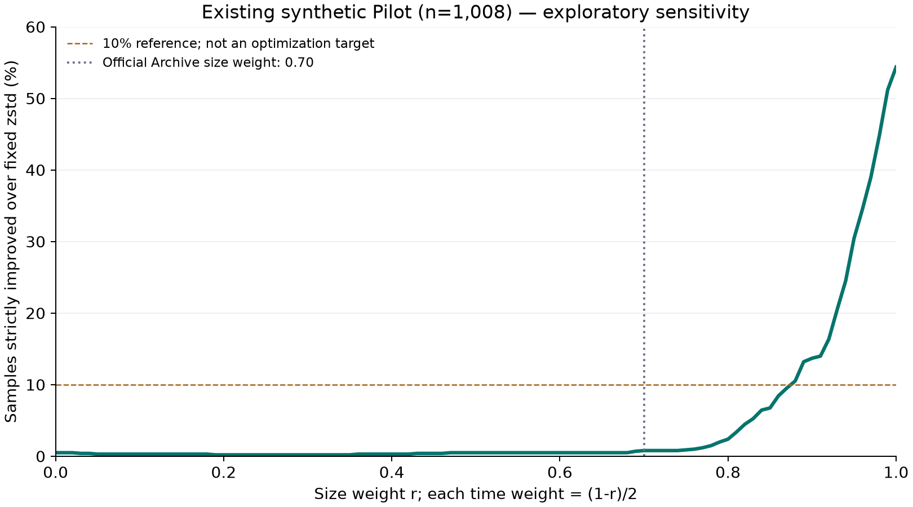

# 기존 Pilot: 압축기별 우세 조건과 점수 민감도 — 2026-10-29

**판정: 다른 압축기의 압축 크기 이점은 존재하지만, 현재 로그 점수에서는 시간 차이가 크게 작용한다. 공식 가중치 채택·라벨 변경은 수행하지 않았다.**

## 범위와 재현 근거

- 입력: 기존 합성 Pilot 1,008개. 과거 측정 실행 commit `4d2d637bea96a4a1ddbbedb2c077fd0474ca8c19`.
- 이번 분석 시작/실행 HEAD: `699801eb536f88613a3ac2409697c404ecc86aa5`. 당시 commit 전 분석 source의 정확한 SHA-256은 summary에 보존했다.
- [분석 전 고정 계획](pilot_tradeoff_plan_20261029.json), [분석기](analyze_pilot_tradeoffs_20261029.py), [저장 결과 독립 검증기](verify_pilot_tradeoffs_20261029.py), [문서·그래프 생성기](publish_pilot_tradeoffs_20261029.py).
- [결과/환경/입력·source·보호 hash](../data/results/pilot_tradeoff_20261029_01/summary.json), [독립 검증](../data/results/pilot_tradeoff_20261029_01/verification.json).
- gzip 9 / bz2 9 / LZMA preset 6 / zstd 3과 기존 5회 중앙값을 사용한다. 새 압축·복원·특징 추출·모델 학습/예측은 실행하지 않았다.
- 기존 Pilot 전체에는 이전 train/test가 포함된다. 이번 결과는 기술적 탐색이며 새 일반화 성능이나 모델 정확도가 아니다. 수집한 실제 unseen 후보는 사용하지 않았다.
- Memory 값은 기존 Pilot에 없다. 추정·보충·4지표 점수 생성 없이 `validation_only`와 참고 지표 방침을 유지한다.

## 지표별 실제 우세

| 단일 지표 | gzip 단독 최저 | bz2 단독 최저 | LZMA 단독 최저 | zstd 단독 최저 | 동점 |
|---|---:|---:|---:|---:|---:|
| 압축률 | 0 | 226 | 322 | 460 | 0 |
| 압축 시간 | 3 | 0 | 0 | 1005 | 0 |
| 해제 시간 | 211 | 0 | 0 | 794 | 3 |

압축 크기에서는 zstd보다 좋은 파일이 548개(54.37%)다. 이 파일들에서 그때의 최소 크기 압축기를 선택하면 zstd 대비 크기 절감률은 중앙값 15.92%, 최대 52.37%다. 이 수치는 압축률만의 oracle이며 공식 종합 점수의 정답/모델 성능과 구분한다.

| 비교 대상 | zstd보다 작은 파일 | 작을 때 크기 절감률 중앙값 | 작을 때 절감 bytes 중앙값 | 압축이 더 빠른 파일 | 해제가 더 빠른 파일 |
|---|---:|---:|---:|---:|---:|
| gzip | 400 | 7.68% | 2,051.5 | 3 | 211 |
| bz2 | 481 | 13.54% | 4,927.0 | 0 | 0 |
| lzma | 521 | 13.98% | 4,367.0 | 0 | 1 |

각 행은 해당 압축기와 zstd의 pairwise 비교다. 한 파일이 여러 행에 포함될 수 있으며 단독 최저 빈도와 다르다.

## 어떤 데이터에서 차이가 나는가

| Generator | 파일 수 | zstd보다 작게 압축 가능 | zstd보다 빠르게 해제 가능 | Archive 비-zstd 선택 |
|---|---:|---:|---:|---:|
| long_runs | 168 | 42 | 57 | 0 |
| mixed | 168 | 168 | 14 | 0 |
| random | 168 | 0 | 4 | 0 |
| repeated_pattern | 168 | 8 | 12 | 0 |
| small_alphabet | 168 | 162 | 61 | 0 |
| structured | 168 | 168 | 63 | 8 |

structured·mixed에서 다른 압축기의 크기 이점이 자주 나타나지만, 그 사실만으로 종합 선택이 바뀌지는 않는다. Generator 이름은 실험 조건이며 실제 파일 형식/특징에 대한 일반화 규칙이 아니다.

| 원본 bytes | 파일 수 | zstd보다 작게 압축 가능 | Archive 비-zstd 선택 |
|---|---:|---:|---:|
| 16,384 | 252 | 126 | 1 |
| 65,536 | 252 | 120 | 3 |
| 262,144 | 252 | 126 | 2 |
| 1,048,576 | 252 | 176 | 2 |

[Generator×size 전체 표](../data/results/pilot_tradeoff_20261029_01/group_summary.csv), [파일별 조건/선택/Pareto](../data/results/pilot_tradeoff_20261029_01/per_sample.csv), [전체 pairwise 절감값](../data/results/pilot_tradeoff_20261029_01/pairwise_vs_zstd.csv)을 보존했다.

## 공식 점수와 개선 폭

| 모드 | gzip | bz2 | LZMA | zstd | 비-zstd 비율 | zstd 고정 사용의 평균 regret | 최대 regret |
|---|---:|---:|---:|---:|---:|---:|---:|
| archive | 8 | 0 | 0 | 1000 | 0.79% | 0.00053551 | 0.12640529 |
| balanced | 5 | 0 | 0 | 1003 | 0.50% | 0.00024587 | 0.09493620 |
| fast_access | 12 | 0 | 0 | 996 | 1.19% | 0.00250737 | 0.38295156 |

Regret는 `zstd 점수 − 해당 모드 최소 점수`이며 무차원 로그 점수 차이다. 속도 개선률이나 정확도가 아니다. Archive에서 고정 zstd 대신 oracle 선택을 했을 때 전체 파일 평균 압축 bytes 절감은 84.77 bytes이고, 압축 시간 절감은 -0.065007 ms다. 음수 절감은 비용 증가를 뜻한다. 선택 비율과 각 비용의 변화는 함께 평가해야 한다.

Pareto front 포함 빈도: gzip 477개, bz2 467개, lzma 506개, zstd 1008개. zstd가 다른 모든 압축기를 지배한 파일은 398개다. Pareto 포함은 어떤 가중치에서 반드시 선택된다는 뜻이 아니다. 지배 관계는 양의 가중치에서의 개선 가능성만 제한하며 가중치 0의 동점은 별도다.

## 가중치 민감도: 채택안이 아닌 탐색

기존 식 $S=w_C\ln(C/C_{min})+w_c\ln(T_c/T_{c,min})+w_d\ln(T_d/T_{d,min})$을 유지했다. 전체 단체 격자는 $w_C+w_c+w_d=1$, 간격 0.05이고, 별도 경로는 $(r,(1-r)/2,(1-r)/2)$, $r=0,0.01,\ldots,1$이다.

모든 격자점을 보존했으며 특정 결과를 얻은 가중치를 추천/채택하지 않았다. 10%는 설명용 참고선이다. 선택 순서는 정확 동점에서 `gzip,bz2,lzma,zstd`이며 epsilon을 넣지 않았다. 엄격 개선은 선택 점수가 zstd 점수보다 작은 경우다. `>1e-12` count도 별도 저장했지만 이 값은 시간 측정 오차나 통계적 유의성 기준이 아니다.

| 압축률 가중치 r | 각 시간 가중치 | 비-zstd 엄격 개선 비율 | gzip / bz2 / LZMA 선택 수 |
|---:|---:|---:|---|
| 0.70 | 0.150 | 0.79% | 8 / 0 / 0 |
| 0.75 | 0.125 | 0.89% | 9 / 0 / 0 |
| 0.80 | 0.100 | 2.38% | 18 / 6 / 0 |
| 0.85 | 0.075 | 6.75% | 35 / 33 / 0 |
| 0.87 | 0.065 | 9.52% | 26 / 68 / 2 |
| 0.88 | 0.060 | 10.52% | 6 / 76 / 24 |
| 0.90 | 0.050 | 13.69% | 2 / 89 / 47 |
| 0.95 | 0.025 | 30.46% | 16 / 171 / 120 |
| 1.00 | 0.000 | 54.37% | 0 / 226 / 322 |

이 경로의 0.01 간격 격자에서 10%를 처음 넘은 지점은 `(0.88, 0.06, 0.06)`이고 비율은 10.52%다. 이는 연속 구간의 정확한 경계나 최적 가중치라는 뜻이 아니다. 현재 Archive보다 시간 합계 비중을 크게 줄인 경우다. 예컨대 0.75/0.125/0.125에서는 변화가 작았다. 앞서 제안한 memory 포함 식의 성능으로 해석할 수 없다.

전체 0.05 격자 231개 중 엄격 개선 비율이 10% 이상인 점은 31개, 모든 가중치가 양수인 점에서는 7개다. 영 가중치 경계와 동점만으로 비-zstd가 선택된 수를 CSV에서 구분한다. 유한 격자 결과로 전체 연속 가중치 공간을 단정하지 않는다.

[전체 0.05 격자](../data/results/pilot_tradeoff_20261029_01/weight_simplex.csv), [전체 0.01 경로](../data/results/pilot_tradeoff_20261029_01/equal_time_path.csv).

## 검증·한계·다음 결정

- 원래 실험 metadata의 입력 hash·설정·성공 상태·전체 sample/알고리즘 coverage와 모든 공식 점수/정답을 재계산했다. 기존 Pilot/모델/config/공식 점수 코드 등 보호 파일 59개의 SHA-256이 그대로다.
- 독립 저장 검증에서 pairwise 4,032행과 가중치 조건 332개 전체의 선택·엄격 개선·평균 regret, 파일별 지표/Pareto 및 그룹 선택 수를 원래 측정값과 대조했다.
- 인위적 수학 fixture 전용 테스트 8개 통과(0.034초). 최초 제한 실행에서는 임시 폴더 접근 거부로 2개가 오류였고 승인 실행에서 모두 통과했다. 분석 오류를 수정하거나 연구 값을 변경한 사례는 아니다. 기존 전체 suite는 재실행하지 않았다.
- 과거 반복 원시 시간은 이 분석에서 확보하지 않았다. 저장 중앙값의 작은 차이를 통계적 유의성으로 판단하거나 절전·스케줄링 영향을 배제할 수 없다.
- 압축 수준별 효과, 새 실제 자료, memory, 특징·추론·검증·I/O를 포함한 전체 시간 및 최종 일반화 성능은 이번 결과로 입증하지 않는다.
- 다음 연구 결정은 보관 기간·복원 빈도·허용 지연·메모리 제한 등 실제 요구를 먼저 명시하고 후속 목적 함수/검증 계획을 별도 버전으로 정하는 것이다. 탐색에 쓴 Pilot을 최종 독립 평가 자료로 주장하지 않는다.
- 사용자 수동 Compare는 화면상 완료를 확인했지만 원시 반복/점수/Demo/로그의 정식 저장 검증과 GUI 전체 시각 QA는 별도 미완료다. 실제 corpus 선정/동결·평가도 미수행이다.
